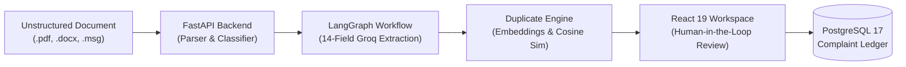
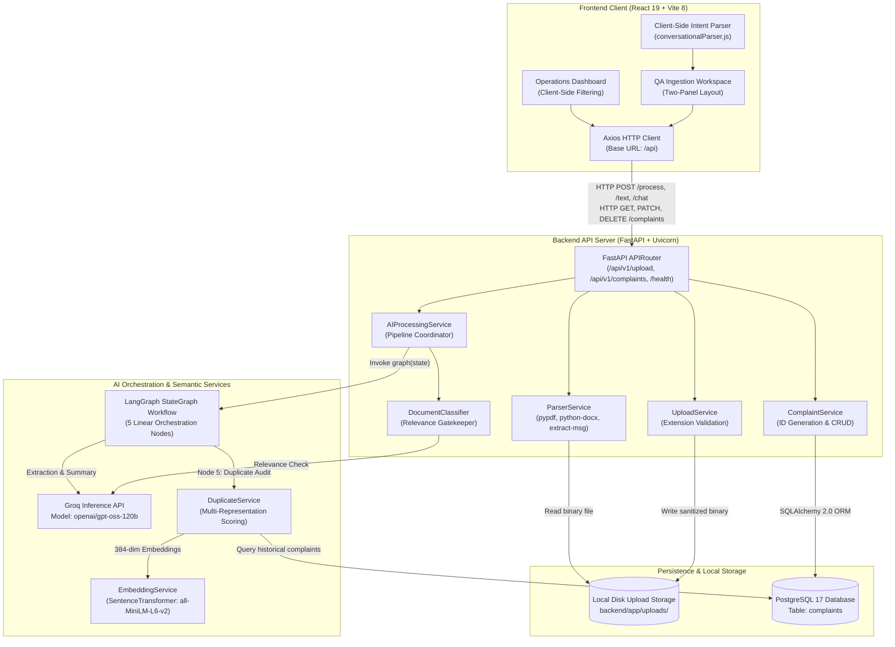
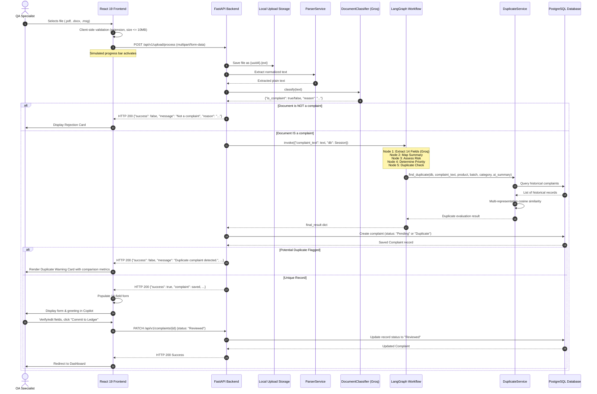
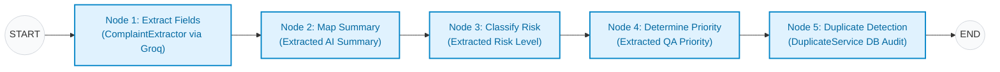
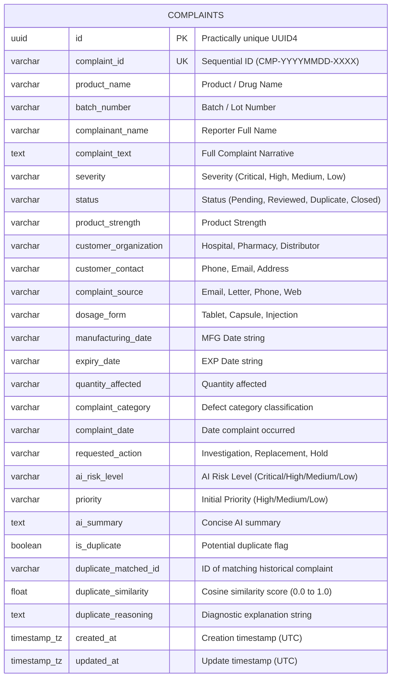

# PharmacoGuard
### AI-Powered Pharmaceutical Quality Management System (QMS) Ingestion Workspace

[](https://fastapi.tiangolo.com)
[](https://react.dev)
[](https://vitejs.dev)
[](https://langchain-ai.github.io/langgraph/)
[](https://groq.com)
[](https://www.postgresql.org)
[](https://huggingface.co/sentence-transformers/all-MiniLM-L6-v2)
[](https://tailwindcss.com)

---

## ⚡ Executive Summary (Recruiter & Interviewer Overview)

**PharmacoGuard** is a full-stack Quality Assurance (QA) ingestion workspace that streamlines how pharmaceutical quality complaints are captured, triaged, and reviewed. When unstructured documents (customer letters, distributor emails, laboratory reports) arrive, the platform validates their medical relevance, parses 14 standardized QMS fields using a 5-node LangGraph workflow on Groq (`openai/gpt-oss-120b`), flags potential batch duplicates using multi-representation sentence embeddings (`all-MiniLM-L6-v2`), and presents the data in an interactive two-panel React 19 workspace for human review prior to ledger persistence.

### Quick Architectural Snapshot
* **Frontend**: React 19, Vite 8, Tailwind CSS 4, Redux Toolkit (dashboard registry), local component state (intake form and chat).
* **Backend**: Python (verified on 3.13.7 / 3.11+), FastAPI, SQLAlchemy 2.0 ORM, Alembic migrations, Uvicorn ASGI server.
* **AI & NLP**: LangGraph (5-node linear state graph), Groq Inference API (`openai/gpt-oss-120b`), Sentence Transformers (`all-MiniLM-L6-v2` 384-dimensional dense embeddings), Scikit-Learn (cosine similarity).
* **Database**: PostgreSQL 17 (relational persistence, sequential `CMP-YYYYMMDD-XXXX` IDs, practically unique UUID primary keys).



---

## 📸 Application Screenshots

| Landing Page | Intake Workspace |
| :---: | :---: |
|  |  |

| Operational Dashboard | Semantic Duplicate Detection |
| :---: | :---: |
|  |  |

---

## 📌 Table of Contents

1. [Project Overview & Business Problem](#1-project-overview--business-problem)
2. [Key Features](#2-key-features)
3. [System Architecture](#3-system-architecture)
4. [End-to-End Document Processing Pipeline](#4-end-to-end-document-processing-pipeline)
5. [LangGraph Orchestration Architecture](#5-langgraph-orchestration-architecture)
6. [Semantic Duplicate Detection Engine](#6-semantic-duplicate-detection-engine)
7. [QA AI Copilot & Conversational Parser](#7-qa-ai-copilot--conversational-parser)
8. [Database Architecture & Ledger Schema](#8-database-architecture--ledger-schema)
9. [Technology Stack](#9-technology-stack)
10. [API Documentation](#10-api-documentation)
11. [Repository Structure](#11-repository-structure)
12. [Local Setup & Execution Guide](#12-local-setup--execution-guide)
13. [Manual Testing & Interview Walkthrough](#13-manual-testing--interview-walkthrough)
14. [Automated & Regression Testing](#14-automated--regression-testing)
15. [Security, Limitations & Future Roadmap](#15-security-limitations--future-roadmap)
16. [Technical Interview Cheatsheet](#16-technical-interview-cheatsheet)

---

## 1. Project Overview & Business Problem

### The Business Challenge
In pharmaceutical operations, product quality complaints arrive continuously from hospitals, retail pharmacies, and distributors via unstructured narratives. Examples include:
* **Foreign Particles**: Black specks, hair, or glass embedded in tablets or ampoules.
* **Packaging Integrity**: Defective blister strip seals, leaking bottles, damaged crimp seals.
* **Physical Defects**: Cracked cores, capping, discoloration, or sedimentation.
* **Labeling / Traceability**: Mismatched batch codes between cartons and primary packaging.

### Operational Pain Points
1. **Manual Data Entry**: QA specialists spend 20–30 minutes per incident extracting up to 14 discrete data fields into an electronic QMS.
2. **Batch Blindspots**: When different pharmacies report identical packaging defects using varied vocabulary, manual triage often fails to correlate them, missing batch-wide quality signals.
3. **Inconsistent Triage**: Different reviewers assign divergent risk levels to comparable defects.

### The PharmacoGuard Solution
PharmacoGuard automates document classification, structured extraction, and semantic duplicate detection while strictly preserving human verification:
* Documents are automatically checked for relevance before entering processing.
* 14 standard QMS fields are extracted into an interactive form.
* Potential duplicates are identified and surfaced with similarity scores and comparative metadata.
* Complaints are initially recorded in the database with `Pending` status (or `Duplicate` if flagged during triage); a human reviewer verifies or edits the data before committing the record to `Reviewed` status.

*(Disclaimer: PharmacoGuard is an engineering prototype and portfolio demonstration. It is not certified for FDA 21 CFR Part 11 or EU GMP Annex 11 compliance).*

---

## 2. Key Features

1. **Multi-Format Document Upload**: Accepts binary files in `.pdf`, `.docx`, and `.msg` formats.
2. **Text Extraction Engine**: Robust file parsing via `pypdf`, `python-docx`, and `extract-msg` with whitespace normalization and null-byte removal.
3. **Direct Text Ingestion**: Dedicated endpoint and UI paste area for email bodies or call transcripts without file creation.
4. **Binary Relevance Classification**: LLM-based gatekeeper that rejects non-complaint documents (e.g., invoices, resumes, manuals) before workflow execution.
5. **Structured 14-Field QMS Extraction**: Extracts product name, strength, dosage form, batch number, manufacturing date, expiry date, affected quantity, complaint category, severity, complainant name, organization, contact, source, and requested action.
6. **AI Complaint Summarization**: Generates a standardized 2-to-3 sentence executive summary.
7. **Risk & Priority Mapping**: Standardizes risk (`Critical`, `High`, `Medium`, `Low`) and operational priority (`High`, `Medium`, `Low`).
8. **Multi-Representation Semantic Duplicate Detection**: Embeds both narrative text and AI summary to compute cosine similarity, applying dynamic thresholds (70% for batch matches, 85% otherwise).
9. **Interactive QA AI Copilot**: Context-grounded assistant answering questions strictly using the uploaded narrative.
10. **Natural-Language Form Corrections**: Client-side regex intent parser that intercepts commands (e.g., *"change batch number to B-99"*) to update and highlight form fields.
11. **Human-in-the-Loop Verification**: Requires manual confirmation to transition complaints from `Pending` to `Reviewed`.
12. **PostgreSQL Complaint Ledger**: Stores records with sequential `CMP-YYYYMMDD-XXXX` IDs, practically unique UUID primary keys, and audit fields.
13. **Operational Dashboard**: Aggregated metrics, status filtering, and client-side substring search across complaint IDs, products, batches, and organizations.
14. **Case Audit View**: Detailed page displaying complete complaint metadata and timeline.

---

## 3. System Architecture



### Architectural Details

* **Frontend State Separation**: Dashboard metrics and complaint lists use Redux Toolkit ([dashboardSlice.js](frontend/src/store/dashboardSlice.js)), whereas active complaint form values and Copilot chat logs are managed locally in component state ([Complaint.jsx](frontend/src/pages/Complaint.jsx)) to maintain responsive form editing.
* **Upload Isolation**: Files are written to `backend/app/uploads/` using `uuid4()` names to prevent path traversal and overwrites.
* **Database Session Lifecycle**: Handled via FastAPI's dependency injection (`Depends(get_db)`), ensuring connections return to the pool after request completion.

---

## 4. End-to-End Document Processing Pipeline



*(Note: The upload progress bar in `Complaint.jsx` is timer-simulated while waiting for the single asynchronous `POST /api/v1/upload/process` HTTP request to complete).*

---

## 5. LangGraph Orchestration Architecture

PharmacoGuard uses **LangGraph** (`StateGraph`) in [workflow.py](backend/app/ai/workflow.py) to orchestrate document triage across a structured series of nodes.

### Operational State (`ComplaintState`)
```python
class ComplaintState(TypedDict, total=False):
    db: Session                  # Active database session
    complaint_text: str          # Raw document narrative
    extracted_data: dict         # 14-field structured dictionary from LLM
    ai_summary: str              # Concise executive QA summary
    risk_level: str              # Risk level (Critical, High, Medium, Low)
    priority: str                # Initial triage priority (High, Medium, Low)
    duplicate_result: dict       # DuplicateService evaluation report
    final_result: dict           # Standardized API response payload
    error: Optional[str]         # Error container for graceful degradation
```

### Node Sequence Topology



### Node Execution Responsibilities
1. **`extract_fields_node`**: Prompts `openai/gpt-oss-120b` in JSON mode (`temperature=0`) to extract all 14 fields and field confidences into `state["extracted_data"]`.
2. **`generate_summary_node`**: Maps the 2–3 sentence executive summary from the extraction output into `state["ai_summary"]`.
3. **`classify_risk_node`**: Maps the assessed incident risk level (`Critical`, `High`, `Medium`, `Low`) into `state["risk_level"]`.
4. **`determine_priority_node`**: Maps the operational triage priority (`High`, `Medium`, `Low`) into `state["priority"]`.
5. **`duplicate_detection_node`**: Invokes `DuplicateService.find_duplicate()` with the database session, narrative text, product, batch, category, and AI summary, assembling `state["final_result"]`.

### Error Isolation & Non-Determinism Disclosure
* **Error Isolation**: If an exception occurs in any node, it is caught and placed into `state["error"]`. Downstream nodes check for errors and exit early without crashing the server.
* **Deterministic Sequencing vs. LLM Variability**: LangGraph guarantees **deterministic node sequencing and state transitions**. However, LLM completions can exhibit minor phrasing variations between runs.

---

## 6. Semantic Duplicate Detection Engine

Duplicate detection in [duplicate_service.py](backend/app/services/duplicate_service.py) uses a **Multi-Representation Semantic Engine** to catch paraphrased reports that traditional exact-match queries miss.

### Decision Workflow

```mermaid
flowchart TD
    Incoming["Incoming Ingestion Data\n(Product, Batch, Category, Text, Summary)"] --> Normalize["Metadata Normalization\n.strip().lower()"]
    Normalize --> QueryDB[("Query Historical Complaints\nFROM PostgreSQL")]

    subgraph MetadataMatching["Metadata Matching & Audit Extraction"]
        QueryDB --> MatchProd{"Product Name Matches?"}
        QueryDB --> MatchBatch{"Batch Number Matches?"}
        QueryDB --> MatchCat{"Category Matches?"}
    end

    subgraph SemanticScoring["Dual-Representation Embeddings"]
        Incoming --> EmbedText["EmbeddingService.encode(clean_text)\nall-MiniLM-L6-v2 (384-dim)"]
        Incoming --> EmbedSumm["EmbeddingService.encode(clean_summary)\nall-MiniLM-L6-v2 (384-dim)"]

        EmbedText --> SimNarrative["Cosine Sim: Incoming Text vs Historical Text"]
        EmbedSumm --> SimSummary["Cosine Sim: Incoming Summary vs Historical Summary"]

        SimNarrative --> MaxScore["Select Maximum Valid Similarity:\nsim_score = max(narrative_sim, summary_sim)"]
        SimSummary --> MaxScore
    end

    MatchProd -->|Yes/No| EvalThreshold{"Product & Batch Both Match?"}
    MatchBatch -->|Yes/No| EvalThreshold
    MatchCat -->|Diagnostic Info| Reasoning["Record Category Match in Audit Reasoning\n(Does not alter threshold)"]

    EvalThreshold -->|Yes (Exact Batch Match)| Thresh70["Applied Threshold = 0.70 (70%)"]
    EvalThreshold -->|No (Cross-Batch / Default)| Thresh85["Applied Threshold = 0.85 (85%)"]

    MaxScore --> Compare{"sim_score >= Applied Threshold?"}
    Thresh70 --> Compare
    Thresh85 --> Compare

    Compare -->|Yes| FlagDuplicate["Flag Potential Duplicate\n(is_duplicate = True, record matched ID & score)"]
    Compare -->|No| FlagUnique["Mark as Unique\n(is_duplicate = False)"]
```

### Engineering Details
* **384-Dimensional Dense Vectors**: `sentence-transformers/all-MiniLM-L6-v2` encodes text into normalized vectors where dot product equals cosine similarity.
* **Dual-Representation Scoring**: LLM narrative extraction lengths can be asymmetric (e.g., 290 characters vs. 1,162 characters). The service embeds both the narrative and the concise AI summary, selecting the maximum valid score:
  `sim_score = max(narrative_similarity, summary_similarity)`
* **Role of Metadata Matching**:
  * **Product and Batch Matching**: When both product name AND batch number match, the threshold is calibrated to **0.70 (70%)**.
  * **Otherwise**: The threshold is set to **0.85 (85%)**.
  * **Complaint Category Matching**: Category match (`cat_match`) is tracked for diagnostic reasoning in audit logs, but does not alter the similarity threshold or filter candidates out.
* **In-Memory Comparison**: In this implementation, historical records are loaded from PostgreSQL and embedded in memory at evaluation time. While this reduces false negatives from length asymmetry, duplicate detection flags potential duplicates for human review and does not guarantee complete blockage of all variations.

---

## 7. QA AI Copilot & Conversational Parser

```mermaid
flowchart TD
    UserInput["User Enters Message in Copilot Input"] --> CheckMode{"Is Document Ingested & Active?"}

    CheckMode -->|No (Idle Workspace)| TextIngest["Trigger Direct Text Ingestion\nPOST /api/v1/upload/text"]

    CheckMode -->|Yes (Active Document)| ParseIntent["Client-Side Intent Parser\n(conversationalParser.js)"]

    ParseIntent --> RegexMatch{"Matches Command Verbs?\n('change batch to X', 'set severity to High')"}

    RegexMatch -->|Yes (Form Modification)| ClientUpdate["Client-Side Action:\n1. Update formValues[field] = value\n2. Mark field in modifiedFields\n3. Visually highlight field in UI\n4. Append confirmation to Chat Log"]

    RegexMatch -->|No (Analytical Query)| BackendQuery["POST /api/v1/upload/chat\nPayload: {complaint_text, question}"]

    BackendQuery --> GroqCopilot["Groq LLM (openai/gpt-oss-120b)\nGrounded strictly in complaint narrative"]

    GroqCopilot --> CopilotResponse["Return: {answer: '...'}\nAppend Answer to Chat Log"]
```

### Two Distinct Operational Modes
1. **Client-Side Form Modification ([conversationalParser.js](frontend/src/utils/conversationalParser.js))**:
   * Uses regular expressions and keyword maps to match verbs (`change`, `set`, `update`) and field names (`batch`, `severity`, `product`).
   * Updates component state directly without an LLM round-trip, highlighting modified fields in amber.
2. **Backend Analytical Copilot (`POST /api/v1/upload/chat`)**:
   * For general questions (e.g., *"Were any adverse patient events reported?"*), the query and current narrative are sent to Groq.
   * Grounded system prompts instruct the model to answer based only on the provided text, stating when information is missing rather than inventing facts. (Note: LLM completions cannot be guaranteed 100% free of hallucinations; reviewers must verify responses).

---

## 8. Database Architecture & Ledger Schema



### Structured Extraction Fields vs. Ledger Control Fields

| Group | Field Name | Source / Determination | Purpose |
| :--- | :--- | :--- | :--- |
| **Document-Extracted** | `product_name`, `batch_number`, `product_strength`, `dosage_form` | Extracted via Groq from narrative | Primary pharmaceutical product identity |
| **Document-Extracted** | `manufacturing_date`, `expiry_date` | Extracted via Groq from narrative | Batch shelf-life and stability timeframe |
| **Document-Extracted** | `quantity_affected`, `complaint_category`, `severity` | Extracted via Groq from narrative | Scope and nature of product defect |
| **Document-Extracted** | `complainant_name`, `customer_organization`, `customer_contact`, `complaint_source` | Extracted via Groq from narrative | Incident reporter contact identity and origin |
| **Document-Extracted** | `requested_action` | Extracted via Groq from narrative | Customer's requested resolution (quarantine, credit, replacement) |
| **Temporal Incident** | `complaint_date` | Extracted via Groq from narrative | Date the incident occurred or was submitted by customer |
| **AI-Derived Analytics**| `ai_summary` | Generated by Groq in Node 2 | Concise 2–3 sentence executive summary |
| **AI-Derived Analytics**| `ai_risk_level`, `priority` | Mapped in Nodes 3 & 4 | Risk triage categorization and operational priority |
| **Duplicate Audit** | `is_duplicate`, `duplicate_matched_id`, `duplicate_similarity`, `duplicate_reasoning` | Calculated in Node 5 by `DuplicateService` | Audit trail linking potential duplicate incidents |
| **Ledger System Control**| `id` | `uuid.uuid4()` | Practically unique internal primary key |
| **Ledger System Control**| `complaint_id` | `ComplaintService.generate_complaint_id()` | Sequential human-readable business ID (`CMP-YYYYMMDD-XXXX`) |
| **Ledger System Control**| `status` | System lifecycle | `Pending` on intake, `Reviewed` on human verification |
| **Ledger System Control**| `created_at`, `updated_at` | Database server timestamp (UTC) | Immutable audit trail timestamps |

---

## 9. Technology Stack

Verified against [package.json](frontend/package.json) and [requirements.txt](backend/requirements.txt):

| Category | Technology | Verified Version | Purpose |
| :--- | :--- | :--- | :--- |
| **Frontend** | React | `19.2.7` | UI library and concurrent component rendering |
| **Build Tool** | Vite | `8.1.1` | ESM development server and production bundler |
| **State** | Redux Toolkit | `2.12.0` | Global state for dashboard registry and KPI metrics |
| **Styling** | Tailwind CSS | `4.3.3` | Utility-first styling framework |
| **Routing** | React Router DOM | `7.18.1` | Client-side routing (`/`, `/complaint`, `/dashboard`, `/complaint/:id`) |
| **HTTP** | Axios | `1.18.1` | HTTP client configured with `/api` proxy |
| **Backend** | Python | `3.13.7` (3.11+) | Core runtime environment |
| **Framework** | FastAPI | `0.139.2` | Asynchronous REST API framework |
| **ASGI Server**| Uvicorn | `0.51.0` | ASGI application server |
| **ORM** | SQLAlchemy | `2.0.51` | Object-Relational Mapping and session management |
| **Validation** | Pydantic | `2.13.4` | Request and response schema validation |
| **Migrations** | Alembic | `1.18.5` | Version-controlled database schema management |
| **Database** | PostgreSQL | `17` | Relational database (configured on port `5433`) |
| **AI Graph** | LangGraph | `1.2.9` | Stateful 5-node directed graph pipeline |
| **LLM Client** | Groq SDK | `1.5.0` | High-throughput inference for `openai/gpt-oss-120b` |
| **Vectors** | Sentence-Transformers| `5.6.0` | 384-dimensional vector encoding (`all-MiniLM-L6-v2`) |
| **ML Math** | Scikit-Learn | `1.9.0` | Cosine similarity matrix operations |
| **Parsing** | PyPDF / docx / msg | `6.14.2` / `1.2.0` / `0.56.0` | Text extraction from `.pdf`, `.docx`, and `.msg` files |

---

## 10. API Documentation

Interactive documentation is available at [http://localhost:8000/docs](http://localhost:8000/docs) (Swagger UI) and [http://localhost:8000/redoc](http://localhost:8000/redoc).

### Registered REST Endpoints

| Method | Path | Request Payload | Response Model | Description |
| :--- | :--- | :--- | :--- | :--- |
| **GET** | `/health` | *None* | `{"status": str, "service": str}` | System health check probe |
| **GET** | `/` | *None* | `{"message": str, "version": str}` | Root service metadata |
| **POST** | `/api/v1/upload/process` | `multipart/form-data` (`file`) | `dict` (Intake Response) | Ingests `.pdf`, `.docx`, or `.msg`, runs triage pipeline |
| **POST** | `/api/v1/upload/text` | `{"text": str}` | `dict` (Intake Response) | Ingests plain text complaint narratives |
| **POST** | `/api/v1/upload/chat` | `{"complaint_text": str, "question": str}` | `{"answer": str}` | Conversational QA Copilot response |
| **GET** | `/api/v1/complaints` | *None* | `List[ComplaintResponse]` | Retrieves all complaints from PostgreSQL ledger |
| **POST** | `/api/v1/complaints` | `ComplaintCreate` | `ComplaintResponse` (201) | Directly registers a complaint record |
| **GET** | `/api/v1/complaints/{id}` | Path `id` (UUID) | `ComplaintResponse` | Retrieves single complaint detail by UUID |
| **PATCH**| `/api/v1/complaints/{id}` | `ComplaintUpdate` | `ComplaintResponse` | Updates fields or transitions status (`Pending` -> `Reviewed`) |
| **DELETE**| `/api/v1/complaints/{id}`| Path `id` (UUID) | `{"success": true, ...}` | Deletes a complaint record from database |

---

## 11. Repository Structure

```
ai-powered-complaint-management/
├── backend/
│   ├── app/
│   │   ├── ai/
│   │   │   ├── complaint_extractor.py     # 14-field extraction schema and prompt
│   │   │   ├── document_classifier.py     # Binary relevance gatekeeper
│   │   │   ├── embedding_service.py       # SentenceTransformer all-MiniLM-L6-v2 wrapper
│   │   │   └── workflow.py                # 5-node LangGraph StateGraph pipeline
│   │   ├── api/
│   │   │   ├── complaints.py              # Ledger CRUD endpoints
│   │   │   ├── health.py                  # Health check route
│   │   │   └── upload.py                  # /process, /text, and /chat endpoints
│   │   ├── core/
│   │   │   └── config.py                  # Pydantic BaseSettings environment config
│   │   ├── database/
│   │   │   └── database.py                # SQLAlchemy engine & sessionmaker
│   │   ├── models/
│   │   │   └── complaint.py               # SQLAlchemy ORM model (complaints table)
│   │   ├── schemas/
│   │   │   └── complaint.py               # Pydantic Create, Update, Response schemas
│   │   ├── services/
│   │   │   ├── ai_processing_service.py   # LangGraph execution coordinator
│   │   │   ├── complaint_service.py       # Sequential ID generation & DB service
│   │   │   ├── duplicate_service.py       # Multi-representation similarity engine
│   │   │   ├── parser_service.py          # PDF, DOCX, and MSG extractors
│   │   │   └── upload_service.py          # File storage & extension validation
│   │   ├── uploads/                       # Local disk storage for uploaded files
│   │   └── main.py                        # FastAPI entrypoint and CORS middleware
│   ├── migrations/                        # Alembic migration revisions & env.py
│   ├── tests/
│   │   └── test_duplicate_service.py      # Unit test suite for duplicate detection
│   ├── alembic.ini                        # Alembic config
│   ├── requirements.txt                   # UTF-8 encoded backend dependencies
│   └── .env.example                       # Sanitized environment template
│
├── frontend/
│   ├── src/
│   │   ├── api/
│   │   │   ├── apiClient.js               # Central Axios instance (/api base)
│   │   │   ├── complaintApi.js            # Ledger CRUD API calls
│   │   │   └── uploadApi.js               # Upload, text, and chat API calls
│   │   ├── components/
│   │   │   ├── common/                    # Navbar, Sidebar, Card, Button, Loaders
│   │   │   └── complaint/
│   │   │       ├── DuplicateCard.jsx      # Duplicate warning comparison display
│   │   │       ├── WorkspaceCopilot.jsx   # Right panel Copilot chat and intake
│   │   │       └── WorkspaceForm.jsx      # Left panel 14-field editable QMS form
│   │   ├── hooks/
│   │   │   └── useUpload.js               # Upload lifecycle management hook
│   │   ├── pages/
│   │   │   ├── Complaint.jsx              # Two-panel intake workspace
│   │   │   ├── ComplaintDetails.jsx       # Case audit and detail view
│   │   │   ├── Dashboard.jsx              # Operational metrics & search table
│   │   │   └── Home.jsx                   # Public overview landing page
│   │   ├── routes/
│   │   │   └── AppRoutes.jsx              # React Router definitions
│   │   ├── utils/
│   │   │   └── conversationalParser.js    # Client-side intent parser for form edits
│   │   ├── App.jsx                        # Layout container
│   │   └── main.jsx                       # React DOM entrypoint
│   ├── package.json                       # Frontend dependencies and scripts
│   └── vite.config.js                     # Vite build config with /api proxy
│
├── docs/
│   └── images/                            # Application screenshots
├── requirements.txt                       # Root requirements mirroring backend
└── README.md                              # Project documentation
```

---

## 12. Local Setup & Execution Guide

### Prerequisites
* **Python**: `3.13.7` (or `3.11+`).
* **Node.js**: `20.19+` or `22.12+` (tested on Node `v24.11.1`).
* **PostgreSQL**: Version 15+ (tested on PostgreSQL 17).
* **Groq API Key**: Free key from [console.groq.com](https://console.groq.com).

---

### Step 1: Clone Repository
```powershell
git clone https://github.com/Sumeet2005/ai-pharmaceutical-complaint-system.git
cd ai-pharmaceutical-complaint-system
```

---

### Step 2: Configure Environment Variables
Copy the template to create `backend/.env`:
```powershell
copy backend\.env.example backend\.env
```

Configure `backend/.env` with your local credentials:
```env
APP_NAME="AI Pharmaceutical Complaint System"
APP_ENV=development
DEBUG=True

# Adjust host, port (default 5432 or custom 5433), username, and password
DATABASE_URL=postgresql://<DB_USER>:<DB_PASSWORD>@localhost:5433/pharma_complaints

# Groq Cloud API Key and active model
GROQ_API_KEY=<YOUR_GROQ_API_KEY>
GROQ_MODEL=openai/gpt-oss-120b

# CORS configuration
CORS_ORIGINS=http://localhost:5173
```

---

### Step 3: Create PostgreSQL Database
Using PostgreSQL CLI (`psql` or `createdb`):
```powershell
# Using createdb (adjust port if running on 5432 or 5433)
createdb -U postgres -p 5433 pharma_complaints

# Or inside psql:
# CREATE DATABASE pharma_complaints;
```

---

### Step 4: Python Virtual Environment & Migrations
```powershell
# Create and activate virtual environment
python -m venv .venv
.venv\Scripts\Activate.ps1

# Install backend dependencies
pip install -r backend/requirements.txt

# Run Alembic migrations from backend directory
cd backend
alembic upgrade head
cd ..
```

---

### Step 5: Start FastAPI Backend
```powershell
# From repository root
.venv\Scripts\uvicorn.exe app.main:app --app-dir backend --port 8000 --reload
```
Check health at: [http://127.0.0.1:8000/health](http://127.0.0.1:8000/health)

---

### Step 6: Start Frontend Client
Open a second PowerShell terminal:
```powershell
cd frontend
npm install
npm run dev
```
Open [http://localhost:5173](http://localhost:5173) in your browser.

---

## 13. Manual Testing & Interview Walkthrough

1. **Access Workspace (`/complaint`)**: Open the browser and navigate to the intake page.
2. **Upload a Complaint Document**: Upload a pharmaceutical complaint PDF.
   * *Observation*: The progress indicator activates, followed by form population with 14 extracted fields.
   * *Observation*: The record is initially persisted in PostgreSQL with `Pending` status.
3. **Upload Non-Complaint (Negative Path)**: Upload a general invoice or resume.
   * *Observation*: The gatekeeper classifies the document as non-compliant, halts processing, and displays a rejection card.
4. **Interact with Copilot**: In the right panel, ask: *"What packaging defects were noted?"*
   * *Observation*: The Copilot answers using the source narrative context.
5. **Natural Language Form Edit**: Type: *"change batch number to DEMO-2026-999"*.
   * *Observation*: `conversationalParser.js` updates the Batch Number field and highlights it in amber.
6. **Commit to Ledger**: Click **Commit to Ledger** and confirm.
   * *Observation*: `PATCH /api/v1/complaints/{id}` updates the record to `Reviewed` status and redirects to the Dashboard.
7. **Demonstrate Duplicate Detection**: Upload a second document sharing the same product and batch number.
   * *Observation*: The engine scores the dual representations, flags the document as a potential duplicate, and renders a comparison card showing the matched complaint ID.
8. **Dashboard Inspection (`/dashboard`)**: Use the search input to filter records by product or batch. Click a row to open the full case audit view.

---

## 14. Automated & Regression Testing

### 1. Isolated Duplicate Engine Tests ([test_duplicate_service.py](backend/tests/test_duplicate_service.py))
Verifies 7 edge cases (batch match thresholding, summary fallbacks, cross-batch rejection, empty text handling) using mocked embeddings and DB sessions:
```powershell
.venv\Scripts\python.exe backend/tests/test_duplicate_service.py
```
**Output**: `Ran 7 tests in 0.039s - OK`

### 2. Frontend Production Build
```powershell
cd frontend
npm run build
```
**Output**: `✓ built in 475ms` (`dist/assets/index-BHctHbVD.js` gzip: 123.61 kB).

---

## 15. Security, Limitations & Future Roadmap

### Current Design Boundaries
* **No Authentication/RBAC**: The application does not currently feature user login, JWT tokens, or role-based access controls.
* **Local File Storage**: Files are saved to local disk (`backend/app/uploads/`) rather than cloud object storage (S3/GCS).
* **In-Memory Duplicate Scan**: Historical records are embedded in memory at query time, suitable for small-to-medium registries.
* **Extension-Based Check**: File validation inspects extensions (`.pdf`, `.docx`, `.msg`) rather than binary magic bytes.
* **PyTorch Cold Start**: First embedding execution incurs a 5–8 second latency while PyTorch loads `all-MiniLM-L6-v2`.
* **No OCR Engine**: Scanned PDFs without a digital text layer are not parsed.

### Future Roadmap
* [ ] **OAuth2 & RBAC**: Integration with Auth0/Okta for `QA Operator`, `Reviewer`, and `Auditor` roles.
* [ ] **Vector Database Indexing**: Migration to **PostgreSQL `pgvector`** with HNSW indexing for scalable vector retrieval.
* [ ] **Cloud Storage**: Transition from local disk to encrypted Amazon S3 buckets.
* [ ] **OCR Ingestion**: Multimodal OCR pipeline for scanned paper forms.
* [ ] **Asynchronous Workers**: Offload document parsing to Celery / Redis task queues.

---

## 16. Technical Interview Cheatsheet

### 60-Second Elevator Pitch
> *"PharmacoGuard is an AI-powered QMS Ingestion Workspace that streamlines pharmaceutical quality complaint intake. When unstructured documents arrive as PDFs or emails, it validates document relevance, extracts 14 standardized QMS fields using a 5-node LangGraph workflow on Groq, and flags potential duplicates using dual-representation sentence embeddings. Extracted records are displayed in an interactive two-panel React 19 workspace where QA officers can converse with an AI Copilot, edit fields with natural language commands, and verify data before committing the record to a PostgreSQL ledger."*

### Architecture in 30 Seconds
> *"The frontend is built with React 19, Vite 8, and Tailwind CSS 4, using Redux Toolkit for dashboard data and local state for intake forms. The backend uses FastAPI and SQLAlchemy 2.0 connected to PostgreSQL 17 with Alembic migrations. AI tasks are split: Groq (`openai/gpt-oss-120b`) handles document classification, 14-field extraction, and Copilot Q&A, while a local SentenceTransformer (`all-MiniLM-L6-v2`) computes 384-dimensional embeddings for duplicate detection."*

### Explaining the 5 LangGraph Nodes
> *"We use LangGraph for structured, auditable triage execution:*
> 1. **Extract Fields**: *Extracts 14 schema entities via Groq in JSON mode.*
> 2. **Map Summary**: *Isolates the 2-3 sentence executive summary.*
> 3. **Classify Risk**: *Standardizes incident severity into Critical, High, Medium, or Low.*
> 4. **Determine Priority**: *Maps triage priority based on safety and operational response windows.*
> 5. **Duplicate Check**: *Executes dual-representation similarity scoring against database records.*
> *This structure provides clear state transitions, error isolation, and testability."*

### Explaining Duplicate Detection
> *"We implement a multi-representation semantic engine. Because LLM extraction lengths can vary, we embed both the narrative text and the standardized AI summary, selecting the maximum cosine similarity. We dynamically apply a 70% threshold when product and batch match, and an 85% threshold otherwise, flagging potential duplicates for human verification."*

---

## License

This repository is maintained as an engineering portfolio project and technical demonstration.
*(No standalone open-source license file is currently included in the repository).*
